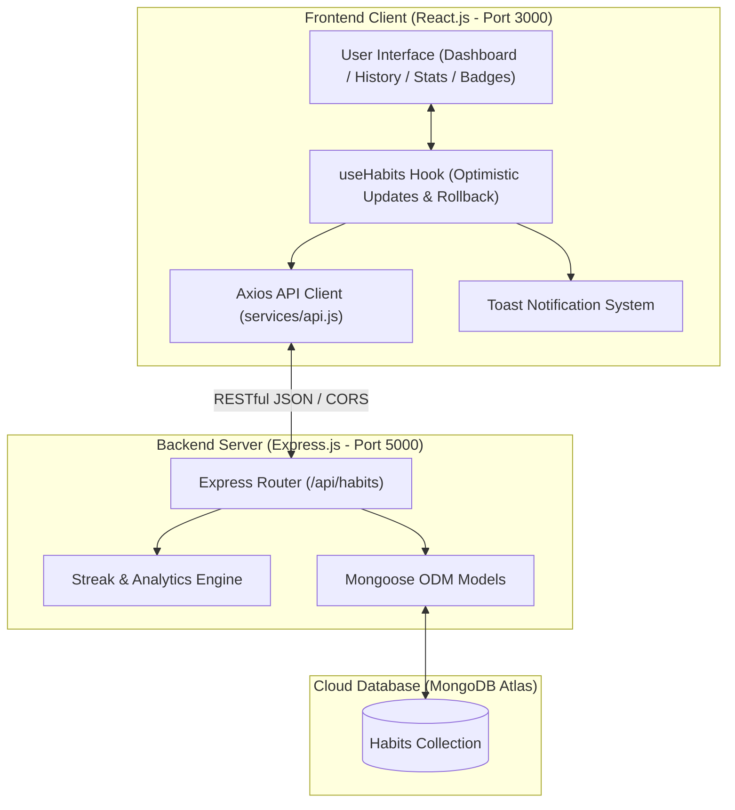

# 🎯 HABITORA — Build Habits. Build Yourself.

> **CodeNova Remote Internship Program — Batch 02**  
> **Track:** Full Stack Development  
> **Task 1:** Full-Stack Habit & Daily Goal Tracker (`CLIENT-SERVER INTEGRATION & STATE`)

---

## 📌 Project Overview

**HABITORA** (*"Build habits. Build yourself."*) is a production-ready, responsive MERN-stack web application designed to help users cultivate positive daily routines, track weekly consistency streaks, and explore data-driven performance trends over time.

Built to exceed all CodeNova Task 1 specifications, HabitPulse implements robust client-server synchronization, persistent cloud database storage with MongoDB Atlas, optimistic frontend updates with error rollback, 12-week GitHub-style activity heatmaps, milestone achievement badges, and dark/light theming.

---

## 🚀 Key Features

### 1. ⚡ Dynamic Dashboard & Daily Progress
- **Animated Progress Ring:** Real-time SVG circular visualizer displaying *"X of Y habits done today"* with motivational milestone messages.
- **Weekly Streak Bar:** Every habit card features a 7-day indicator (Monday–Sunday) for the current week:
  - Completed days are filled with the habit's custom theme color and checkmark.
  - Today is prominently ring-highlighted.
  - Future days are dimmed.
- **Dynamic Flame Milestones:** Flame icon (`🔥`) scales dynamically as streaks grow (`3+ days`, `7+ days on fire!`).
- **Undo Check-in:** Completed habits can be toggled to undo check-in for the current day without page reloads.
- **Check-in Notes:** Optional single-line notes (e.g., *"Ran 5km in 25 mins"*) attached to daily completions.

### 2. 🔍 Real-Time Search, Filter & Sort
- **Instant Search:** Filter habits instantaneously by title or description keywords.
- **Status Chips:** Filter by `All`, `Daily`, `Weekly`, `Done Today`, or `Pending`.
- **Category Tags:** Filter by `Health`, `Study`, `Hobby`, `Work`, or `Other`.
- **Flexible Sorting:** Sort by `Newest First`, `Highest Streak ↓`, or `Alphabetical (A-Z)`.

### 3. 📅 Historical Analytics & GitHub-Style Heatmap
- **12-Week Activity Heatmap:** 84-day contribution grid shaded by daily check-in volume with interactive day-inspection tooltips.
- **Interactive Monthly Calendar:** Color-intensity-coded monthly grid with previous/next month navigation.
- **Day Detail Drawer:** Clicking any calendar or heatmap day reveals the exact habits completed on that date, complete with icons, categories, and attached notes.

### 4. 📊 Performance Metrics & Data Portability
- **KPI Dashboard:** Best active streak, all-time longest streak, total check-ins, and most productive day of the week.
- **Consistency Rates:** Algorithmic calculation of current weekly and monthly consistency percentages.
- **Check-ins by Day of Week:** Visual distribution histogram identifying peak performance days.
- **Category Breakdown:** Proportional progress bars illustrating habit distributions across domains.
- **One-Click Data Export:** Export full habit datasets and completion logs as formatted **CSV** or **JSON**.

### 5. 🏆 Achievement Badges
- Gamified milestone system with 6 unlockable badges:
  - 🌱 **First Step:** Complete your first habit check-in.
  - 🔥 **Momentum Builder:** Reach a 3-day streak.
  - ⚡ **Unstoppable Week:** Maintain a 7-day streak.
  - 👑 **Monthly Legend:** Hit a 30-day streak.
  - 🏛️ **Habit Architect:** Create and track 5 or more unique habits.
  - 🏆 **Daily Champion:** Complete all scheduled habits in a single day.

### 6. 🎨 Visual Design & Accessibility
- **Modern Design System:** Built with Poppins typography, subtle glassmorphism, soft drop shadows, and vibrant accent palettes.
- **System Theme Persistence:** Persistent dark/light mode toggle stored in `localStorage`.
- **Non-blocking Toast Alerts:** Slide-in feedback notifications for all CRUD operations, network events, and offline rollbacks.
- **Graceful Error Handling:** Comprehensive alerts when the backend server is unreachable.

---

## 🛠️ Tech Stack

| Layer | Technology | Role |
|---|---|---|
| **Frontend** | React 18, React Hooks | Reactive single-page UI & state management |
| **Styling** | Custom Vanilla CSS (CSS Variables) | Dark mode themes, responsive grids, micro-animations |
| **HTTP Client** | Axios | RESTful asynchronous client-server communication |
| **Backend** | Node.js, Express.js | Modular REST API routing and streak calculation engine |
| **Database** | MongoDB Atlas, Mongoose 8 | Cloud document persistence, schema validation |
| **Environment** | Dotenv, Nodemon | Secure config isolation and hot-reloading development |

---

## 🏗️ Architecture & Data Flow



---

## 📁 Repository Structure

```
task-1-habit-tracker/
├── .gitignore                      # Git exclusion rules (node_modules, .env)
├── README.md                       # Comprehensive project documentation
│
├── client/                         # React Frontend Application
│   ├── public/                     # Static HTML & browser assets
│   ├── src/
│   │   ├── components/             # Reusable UI components
│   │   │   ├── AddHabitForm.js     # Form with emoji & color selector
│   │   │   ├── DeleteModal.js      # Deletion confirmation modal
│   │   │   ├── EditModal.js        # Habit editing modal
│   │   │   ├── HabitCard.js        # Main habit card with action buttons
│   │   │   ├── NavBar.js           # Navigation bar with dark mode toggle
│   │   │   ├── ProgressRing.js     # SVG circular completion indicator
│   │   │   ├── SearchFilter.js     # Keyword search, category & sort bar
│   │   │   ├── Toast.js            # Toast provider and notifications
│   │   │   └── WeeklyStreakBar.js  # 7-day Monday–Sunday visualizer
│   │   ├── hooks/
│   │   │   └── useHabits.js        # Custom hook with optimistic state updates
│   │   ├── pages/
│   │   │   ├── Badges.js           # Milestone achievement badges
│   │   │   ├── Dashboard.js        # Main habit tracking board
│   │   │   ├── History.js          # Monthly calendar & 12-week heatmap
│   │   │   └── Stats.js            # KPI metrics & data export
│   │   ├── services/
│   │   │   └── api.js              # Centralized Axios API calls
│   │   ├── App.css                 # Master design system & dark mode vars
│   │   ├── App.js                  # App root with tab-based routing
│   │   └── index.js                # React DOM entry point
│   └── package.json
│
└── server/                         # Node.js + Express REST Backend
    ├── models/
    │   └── Habit.js                # Mongoose schema for habits
    ├── routes/
    │   └── habits.js               # REST API endpoints & streak logic
    ├── .env.example                # Sample environment configuration
    ├── index.js                    # Express server initialization
    ├── migrate.js                  # Safe database migration utility
    ├── package.json
    └── schema.sql                  # Multi-database relational schema reference
```

---

## 🗄️ Database Models

### Mongoose Document Model (`models/Habit.js`)
```javascript
{
  name: { type: String, required: true, trim: true },
  description: { type: String, default: '' },
  frequency: { type: String, enum: ['daily', 'weekly'], default: 'daily' },
  category: { type: String, enum: ['Health', 'Study', 'Hobby', 'Work', 'Other'], default: 'Other' },
  color: { type: String, default: '#6366f1' },
  icon: { type: String, default: '🎯' },
  streak: { type: Number, default: 0 },
  completedDates: { type: [String], default: [] }, // Array of YYYY-MM-DD
  note: { type: String, default: '' },
  createdAt: ISODate,
  updatedAt: ISODate
}
```

---

## 📡 REST API Reference

All routes are served under the `/api/habits` prefix:

| Method | Endpoint | Description | Request Body Example | Response |
|---|---|---|---|---|
| `GET` | `/api/habits` | Fetch all habits sorted by creation date | None | `200 OK` (Array of habits) |
| `GET` | `/api/habits/stats` | Compute aggregate statistics & rates | None | `200 OK` (Stats object) |
| `GET` | `/api/habits/:id` | Retrieve single habit details | None | `200 OK` / `404 Not Found` |
| `POST` | `/api/habits` | Create a new habit | `{"name":"Morning Run","frequency":"daily","category":"Health","color":"#10b981","icon":"🏃‍♀️"}` | `201 Created` |
| `PUT` | `/api/habits/:id` | Update habit properties | `{"name":"Evening Walk","color":"#3b82f6"}` | `200 OK` |
| `POST` | `/api/habits/:id/checkin` | Check in for today with optional note | `{"note":"Completed 5 km"}` | `200 OK` / `400 Bad Request` |
| `DELETE` | `/api/habits/:id/checkin` | Undo today's check-in | None | `200 OK` / `400 Bad Request` |
| `DELETE` | `/api/habits/:id` | Permanently delete a habit | None | `200 OK` |

---

## 💻 Local Setup & Installation

### Prerequisites
- **Node.js** (v18.x or higher)
- **npm** (v9.x or higher)
- Free **MongoDB Atlas** database connection string (or local MongoDB on port 27017)

### 1. Clone or Open the Repository
```bash
cd "C:\habbit_tracker\task-1-habit-tracker"
```

### 2. Configure Backend Environment
Navigate to the `server/` directory:
```bash
cd server
copy .env.example .env
```
Open `.env` in your editor and supply your connection string:
```env
MONGO_URI=mongodb+srv://<username>:<password>@cluster0.mongodb.net/habittracker
PORT=5000
```

Install backend dependencies:
```bash
npm install
```

Start the backend server in development mode:
```bash
npm run dev
```
*(Server will listen on http://localhost:5000 and log: `✅ MongoDB connected`)*

### 3. Configure and Launch Frontend
Open a new terminal window and navigate to `client/`:
```bash
cd "C:\habbit_tracker\task-1-habit-tracker\client"
npm install
npm start
```
*(React development server will launch at http://localhost:3000)*

---

## 📸 Screenshots Showcase

| View | Preview |
|---|---|
| **Dashboard (Light Mode)** | Dynamic circular progress ring, weekly streak bars, and category filtering |
| **12-Week Activity Heatmap** | 84-day contribution visualization with intensity-based shading |
| **Monthly Calendar & Day Inspection** | Calendar grid with day click popover showing completed habits |
| **Analytics & KPIs** | Habit completion histogram by day of week and data export controls |
| **Achievement Badges** | Milestone rewards with locked/unlocked gamification states |
| **Dark Mode Theming** | Fully responsive dark aesthetic with persistent preference |

---

## 🛡️ CodeNova Submission Quality Checklist

- [x] **Completed Task 1 Specifications:** Exceeds all mandatory and advanced features.
- [x] **GitHub Repository Visibility:** Ready to push to Public GitHub repository.
- [x] **Zero Paid Tooling:** Built strictly with free open-source dependencies and free-tier cloud persistence.
- [x] **Zero Secret Leakage:** `.env` files protected by `.gitignore`; `.env.example` provided.
- [x] **Cross-Platform Responsive:** Tested across mobile, tablet, and widescreen desktop viewports.
- [x] **Accompanying Documentation:** Setup instructions, API schema, and component documentation included.

---

© 2026 CodeNova Community Batch 02 • Authored by Radhika Patil
